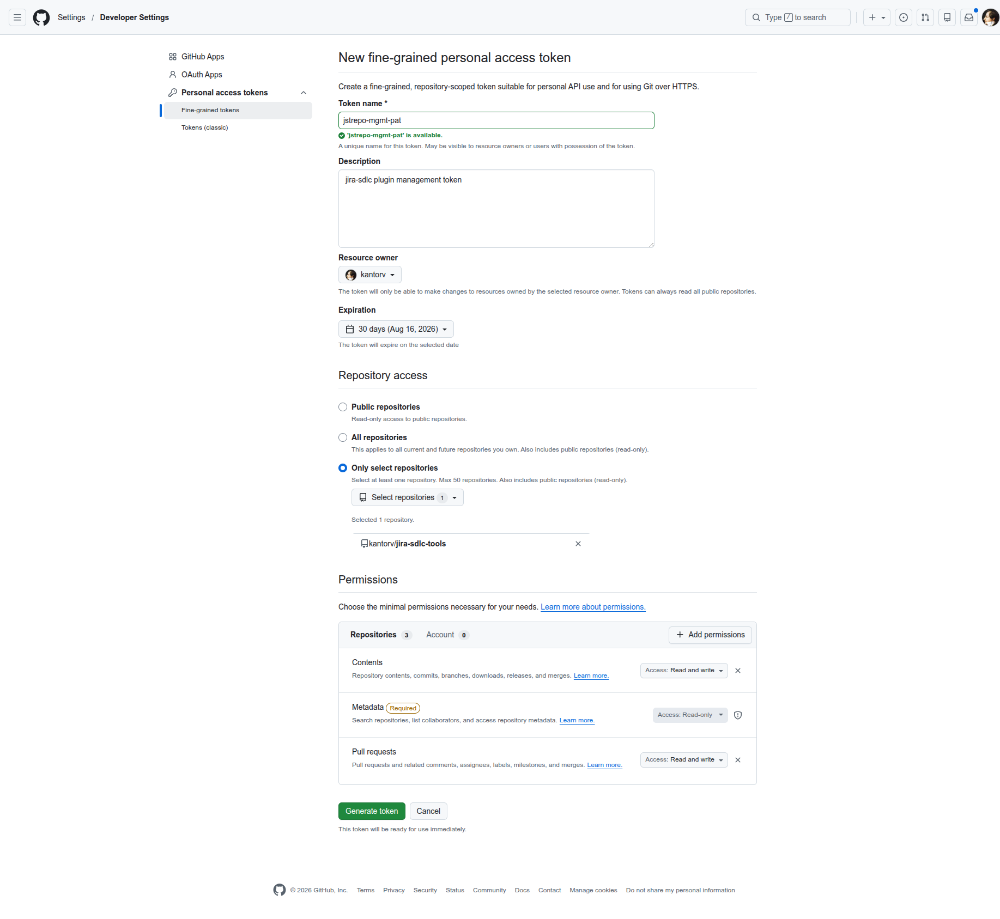

# gh CLI auth — the PAT, per request, no login

The jira-sdlc skills use the GitHub CLI (`gh`) to open, read and review PRs.
Every one of those calls runs through a small wrapper, **`gh.sh`** (and its
Windows twin `gh.ps1`), which reads the project's Personal Access Token and
hands it to that one `gh` command as `GH_TOKEN`. `gh` documents `GH_TOKEN` as
taking precedence over any stored credential (`gh help environment`), so:

- `gh` is **never logged in or out** — no `gh auth login`, no `gh auth logout`,
  anywhere in the plugin;
- `~/.config/gh`, the keyring and **your own `gh` session stay exactly as they
  were** — before, during and after a run;
- two projects with different PATs can run skills **at the same time** without
  either one picking up the other's token.

This replaced the earlier design (JST-143/145/290), in which the healthcheck
logged `gh` out and back in with the PAT at the start of every run and held that
session for the conversation. That wrote OS-user-global state and never restored
it, so your own `gh` ended up holding the last project's PAT, parallel runs in
different projects raced for the one session, and a failed login left `gh`
logged out entirely (JST-331). It is the same move `jira.sh` made for Jira:
per-request credentials instead of a global login (JST-146).

## The setting: `GITHUB_PAT_TOKEN`

A fine-grained GitHub Personal Access Token, scoped to let `gh pr create` open
pull requests on this repo.

It is a **secret, machine-specific** value, so it lives **only** in the
gitignored `.jst/jira-sdlc-tools.local.env` — never in the tracked, team-shared
`.jst/jira-sdlc-tools.env`. This is the same treatment the Jira role tokens
(`JIRA_*_TOKEN`) get: real credentials never enter git history.

`.jst/jira-sdlc-tools.local.env.example` carries a **placeholder** entry
(`GITHUB_PAT_TOKEN="XXXXXXXXXXXXXXXXXX"`) so a new checkout knows the variable
exists; you replace the placeholder with your own token in your local, untracked
`jira-sdlc-tools.local.env`.

## Generating the token

On GitHub, navigate to the fine-grained token creation view:

1. Click your **profile picture** (top right) → **Settings**.
2. In the left sidebar, **Developer settings** → **Personal access tokens** →
   **Fine-grained tokens**.
3. Click **Generate new token** (top right).

Then, on the token creation form:

- **Repository access** → **Only select repositories** → pick *this* repo.
- **Permissions** → **Repository permissions**:
  - **Contents** → **Read and write**
  - **Pull requests** → **Read and write**
  - **Metadata** → **Read-only** — GitHub adds this automatically (it's marked
    *Required*); leave it as-is.

Those two write scopes are what let `gh pr create` push the branch and open the
PR. Copy the generated token and paste it as `GITHUB_PAT_TOKEN` in your local,
untracked `jira-sdlc-tools.local.env`.



## The wrapper: `gh.sh` / `gh.ps1`

```bash
bash "${CLAUDE_PLUGIN_ROOT}/skills/_shared/scripts/posix/gh.sh" pr create -R <owner>/<repo> …
pwsh -File <plugin-root>\skills\_shared\scripts\win\gh.ps1 pr create -R <owner>/<repo> …
```

It takes any `gh` arguments and passes them, `gh`'s output and its exit code
through unchanged. It finds `.jst/jira-sdlc-tools.local.env` from the project
root, so it works the same from a linked worktree and from inside a member
submodule, and reads the one `GITHUB_PAT_TOKEN` line from it (the file is
parsed, never sourced: it also holds the Jira role tokens). It adds two errors
of its own, both on stderr prefixed `jst-gh:`:

| exit | meaning |
| -- | -- |
| `4` | `GITHUB_PAT_TOKEN` is unset — `gh`'s own "authentication required" code. **Never** a fallback to the stored `gh` session: that is whoever logged `gh` in last, possibly for another project. |
| `127` | `gh` itself isn't installed |

The skills call it for every `gh` command they make, and `repos.sh` (which opens
and reads the PRs) calls it for every network request. On Windows,
`statuscheck.ps1` and `repos.ps1` dot-source `gh.ps1` and call its
`Invoke-JstGh` function, which does the same in-process.

Since the token never goes through a pipe, the Windows PowerShell 5.1 BOM
problem the old login had to work around (JST-171: 5.1 prepends a UTF-8 BOM to
a string piped into a native command, so a valid PAT drew a `401`) no longer
applies.

## What the healthcheck does

The `gh_auth` row runs `gh.sh api user --jq .login` — an authenticated
`GET /user` — and reports the account the PAT belongs to. It changes nothing:
running statuscheck leaves `gh auth status` and `~/.config/gh` exactly as they
were, so it is safe to run on a schedule.

- **Token missing** → `FAIL`, naming the file, with the remedy *add
  `GITHUB_PAT_TOKEN` to `.jst/jira-sdlc-tools.local.env`*.
- **Token rejected** (expired, revoked, mistyped) → `FAIL` relaying `gh`'s
  first error line, token redacted — e.g. `HTTP 401: Bad credentials`.
- **Network error** → the same `FAIL`; re-running usually clears it.

Like every `FAIL` row, either one stops the run before any branch, commit, push
or PR, so a run can't get most of the way through and only then discover that
it can't open its PR.

## Authenticating is not access: the `gh_repo_access` row

`gh_auth` proves the token authenticates, and nothing more. A fine-grained PAT
scoped to **only selected repositories** authenticates green, reads the org and
every *other* repo it was granted, and still cannot see this one — and GitHub
answers **404, not 403**, for a repository a token has no access to, so it reads
like a typo in the repo name. With an SSH `origin`, every `git` operation keeps
working, and the first thing to break is `gh pr create` in the executor:
mid-task, after the work is committed and pushed.

So the healthcheck also probes the repository itself, in a separate
`gh_repo_access` row — `gh.sh api repos/<OWNER>/<REPO>`, resolved from `origin`
(REST; `gh repo view` goes through GraphQL and fails with a different, less
legible error). A 404 there `FAIL`s with the real remedy: add the repo to the
token's repository access at
[github.com/settings/personal-access-tokens](https://github.com/settings/personal-access-tokens),
keeping **Contents: read/write** and **Pull requests: read/write** — and expect
an org-owned repository to need an org admin to approve the token as well. In a
project with member repos, each `member_repo[…]` row runs the same probe on its
member.

## Your own `gh` login

It's yours, and the skills leave it alone: log in with whatever account and
scopes you like (see
[`gh auth login`](../STEP-BY-STEP-INSTALLATION/environment-setup/github/authentication/gh/gh-auth-login.md)
for debugging that needs more than the PAT allows). Being logged out is fine
too — the skills don't need a stored session at all.

A plain `gh …` you type yourself still uses your own session, not the PAT. To
see what the skills see, run the command through the wrapper instead.

## Out of scope

- **Per-role GitHub identities** — one shared PAT is used, not a separate token
  per skill role. (Jira does use per-role accounts; GitHub does not.)
- **GitHub App tokens** and other auth methods.
- **Merges** remain human-only.
- **git remote / `git push` auth** is unchanged — this is specifically about the
  `gh` CLI.
