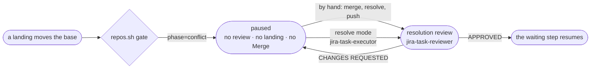

# Task lifecycle: a merge conflict pauses the issue

When issues run in parallel, one landing can move the base under another issue's
branch so that the two no longer merge. The skills treat that as a state of the
issue's flow, not as a dead end in a run's prose: the flow **pauses**, someone
resolves the conflict, the resolution is **reviewed**, and the step that was
waiting resumes.



## Detecting it: the gate's `conflict`

`repos.sh gate` reads `phase=conflict` when the issue's branch conflicts with its
base in a repo whose merge is still ahead. It replaces `review`, `land` and
`review-landing`, each of which would start a review or a merge. Its `reason=`
names the repo and the files. A `sensitive=` line lists the files a human must
resolve, whatever is granted.

`repos.sh conflicts` gives the rows behind it, one per repo and base (or another
issue's branch): `repo against result files sensitive recipe`.

- `sensitive` marks the project's own machinery (`.jst/`, `stack`, `stack.d/`,
  `.github/workflows/`) and database migrations.
- `recipe` marks the files a mechanical recipe resolves:
  - `gitlink:<path>`: a member pointer where one side's commit contains the
    other's;
  - `migration-number:<path>`: both sides added a numbered migration at the same
    path.

A gate that can't read the state (a failed fetch, a `gh` error) says
`phase=stop` with `unknown=conflicts` or `unknown=prs`. That is unknown, not a
lifted pause.

While paused, the reviewer stops on `conflict` (its phase table) and lands
nothing.

## Resolving it: the executor's resolve mode

A run of `jira-task-executor` whose notes' first line is `mode=resolve-conflicts`
resolves the pause instead of implementing the issue. Its procedure is
`plugins/jira-sdlc/skills/_shared/resolve-conflicts.md`:

1. Read the gate and the `conflicts` rows: the files to resolve, which are
   sensitive, which a recipe covers.
2. Read both intents: this issue's description, and the description and diff of
   the issue whose landing moved the base (its key is on the landing commit).
3. Merge the base: the root's merge, and `repos.sh sync` for members.
4. Resolve only the files the gate named, keeping both sides' intent hunk by
   hunk, recipes first. A sensitive file needs the notes' `sensitive=yes`, which
   means a human chose the agent for it.
5. Add tests for any semantic overlap, and run the project's gates on the
   merge result.
6. Push one merge commit per repo, with a `Conflict-Resolved: <files>` trailer.
7. Check that the gate no longer reads `conflict`, and report each hunk: what
   it kept from each side, and the recipes it used.

It stops and asks on anything else: a file the gate didn't name, a gate it can't
fix within the resolution, a conflict whose two intents it can't read. It ends
with a marker line:

```
CONFLICT RESOLVED <repo>@<sha> [<repo>@<sha> …]
CONFLICT NOT RESOLVED: <reason>
```

Every other executor run keeps its rule: it never resolves a merge conflict on
its own.

## Reviewing it: the resolution review

A merge that resolved a conflict is code no review saw. `repos.sh resolutions`
lists those merges on the branch, newest first: `repo commit by files`, where
`by` is `agent` (the trailer) or `hand`.

When the reviewer finds its own latest verdict on a PR is `APPROVED —`, it reads
what was pushed since with `repos.sh since`. When the only new commits are such
merges (and clean merges of the base), it runs the **resolution review** (`plugins/jira-sdlc/skills/_shared/resolution-review.md`).
It doesn't review the whole diff again. It checks the merge's resolution
(`git show --remerge-diff`) against both sides:

- each hunk keeps both intents;
- nothing beyond the conflict changed;
- the overlap is tested;
- the gates pass;
- recipes were applied correctly.

Its verdict is the review after the merge commit. A run whose notes start
`mode=resolution-review` asks for this same check. Anything else pushed since
the approval is code no review read, so it gets a full re-review, whatever the
notes say: a plain commit, a rebase or force push (the head no longer contains
the approved commit), or a clean merge carrying edits of its own.

## In the web app

The web control plane drives this flow. It reads the gate's `conflict` as the
pause and shows it as a question:

- resolve it myself (the worktree, then Refresh);
- let the agent resolve it (resolve mode);
- standing **grants** per project, overridden per issue, which answer the
  question ahead of time. A sensitive path always asks.

After either resolution it runs the resolution review as a fresh run, then
resumes a landing that was waiting, or offers Merge again.
