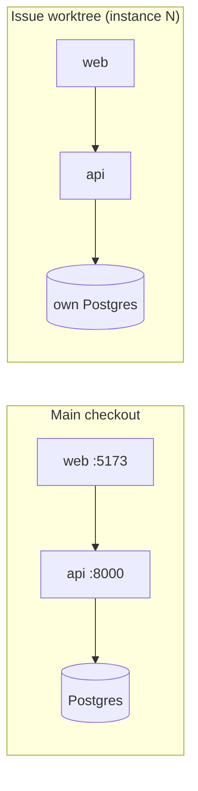

<!-- Adapted from ControlFreak's space-init survey template (controlfreak@7af306f:
plugins/controlfreak/skills/space-init/survey/template.md). Owned here. -->

# The stack document's template

`jst-survey` writes `.jst/STACK.md` from this, keeping every section (write "none" where it
applies). The human confirms it by merging its PR; `jst-stack` builds the stack from it, and
refuses to start while any `- [ ]` remains under *Before jst-stack* or *Open questions*.

````markdown
# Stack: <repo name, as on GitHub>

Written by jst-survey on <date> from <base branch> at <short sha>.

## What it is

Two to five sentences: what the app does, its parts, and how they talk to each other.

## Project type

| | Value | Evidence |
| -- | -- | -- |
| Repo layout | `single` / `submodules` / `ignored-members` | the `repo_strategy` row; the members and what each holds |
| Run pattern | `toolchain` / `vite-spa` / `spa-api` / `compose-services` / `submodule-workspace` / `multi-repo-workers` | one line: why this one |

## Components

| Component | What it does | Runs as | Listens on (main) | Ready when |
| -- | -- | -- | -- | -- |
| api | the HTTP API | `python manage.py runserver` | :8000 | `GET /health/` → 200 |
| storybook | component gallery, by hand | `yarn storybook` | :6006 | not run by the stack |

## Resources in two places

Each cell: **shared**, **own copy**, **copied in**, or **absent**, and how, in a few words.

| Resource | Main checkout | Issue worktree (instance N) | Why |
| -- | -- | -- | -- |
| Postgres | the main database (Docker, :5432) | own container, empty + migrated | a branch's migration must not reach the main data |
| `node_modules` | installed | copied in | a lockfile change needs its own |

## Diagram



## What the stack needs from the host

Ports per instance and what each is for; a subnet or not; the names it makes (containers,
networks, volumes, compose projects); prerequisites on the host (Docker, Node, a GPU, …);
shared services the main checkout must have running. When the repo already has
`stack.d/resources.conf`, its values.

## What the executor can check with nothing running

The issue worktree before its instance starts: the commands that work with no services up
(tests, lint, type checks), and which checks need one of the instance's services (a test
suite that needs its database).

## Changes to the existing stack

Only when the repo already has a stack or a worktree hook (`./stack`, `.jst/bootstrap.sh`):
what it does today that this document decides differently, one row each, so `jst-stack`
changes it rather than rebuilding it. "none" otherwise.

| Today | Decided | Why |
| -- | -- | -- |
| the worktree's DB is copied from main and keeps its queued jobs | clear queued and running jobs right after the restore | a copied job re-runs on the shared GPU |

## Before jst-stack

Actions someone must take before the stack can be built: things to do, not decide.

- [ ] <an action, and who does it: "push the 3 local commits on `development` that add `stack.d/`">

## Open questions

Decisions only, each the user's to make. An answered question doesn't stay here: its answer
becomes the decision in the table it belongs to, with its reason.

- [ ] <a decision you couldn't make: the options, and your recommendation>

## Notes

Observations that block nothing: docs that disagree with the code, dead config, a risk
outside the stack. "none" otherwise.

## Changes

- <date> jst-survey: written.
````

**The diagram**: a Mermaid `flowchart` with one subgraph per place, short labels, quoted
when they hold punctuation. Databases as `[(…)]`. An arrow means "uses". A resource both
places share sits outside the subgraphs, with an arrow from each. Never put a `;` in a
label: Mermaid reads it as the end of a statement and the diagram breaks.
